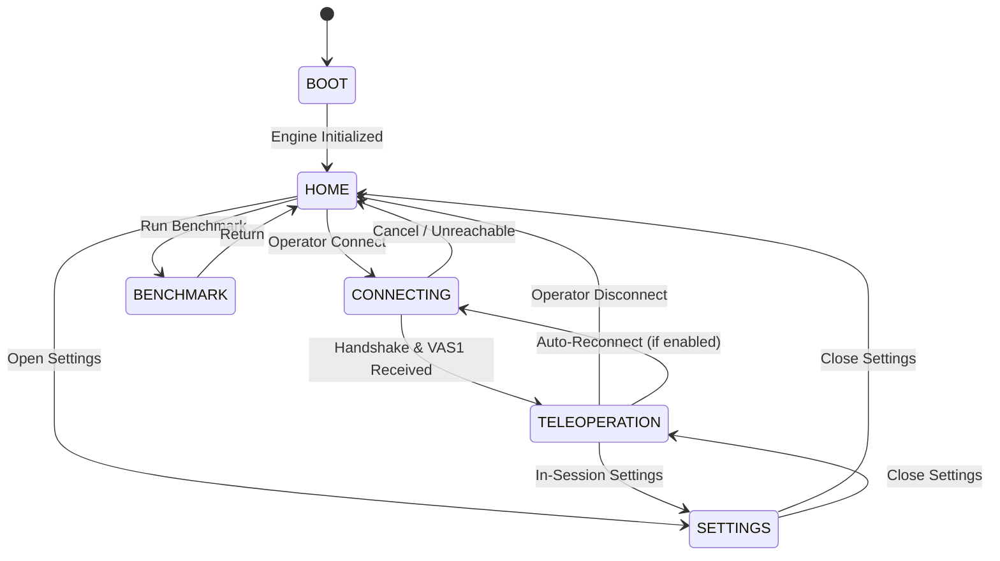

# ASIMOV CONTROLLER 3D
## PHASE 4 ARCHITECTURE SPECIFICATION: PRODUCTION OPERATOR APPLICATION

**Author:** Asimov Robotics Engineering Team  
**Date:** October 2026  
**Status:** IMPLEMENTED & PRODUCTION READY  
**Client Target:** Android (Samsung Galaxy M14 5G / Expo React Native + Three.js)  
**Backend:** VASIMOV Authoritative MuJoCo Physics (200 Hz) + Menlo Locomotion Policy (50 Hz)  

---

## 1. Architectural Mission & Invariants

Phase 4 elevates the engineering benchmark prototype established in Phase 3 into a clean, resilient, operator-facing production teleoperation application.

### Strict Architectural Invariants:
1. **Single Authoritative Source of Truth:** MuJoCo simulation in `vasimov` retains exclusive authority over physics dynamics, collision resolution, joint torques, ground contact forces, and recovery state transitions. The Android client executes **zero physics simulation**.
2. **Clock Decoupling:** Network packet ingestion (50 Hz `VAS1`) never drives the display rendering clock. The local Three.js render loop is driven strictly by Android VSync (60 Hz / nominal 16.67 ms interval).
3. **Decoupled React State:** High-frequency state telemetry is never bound to React component state. Zero component re-renders occur on 50 Hz packets. UI overlays poll diagnostics at a throttled cadence (3 Hz) and receive mode updates only on discrete state transitions.
4. **Canonical Visual Model Preservation:** The validated canonical model [`assets/asimov_1.glb`](file:///home/shubhr/Shubhr/Projects/asimov-controller-3d/assets/asimov_1.glb) (113,436 triangles, 26 links, 25 articulated revolute joints) remains bit-identical and unmodified.
5. **Observation vs Authority:** The optional remote robot camera stream (WebRTC/MJPEG) is strictly an observation channel. It carries zero authoritative kinematic state.

---

## 2. End-to-End System Pipeline

```text
                           VASIMOV BACKEND
                                  │
                          MuJoCo Physics Core
                                200 Hz
                                  │
                     Official Menlo Locomotion Policy
                                 50 Hz
                                  │
                 Authoritative Robot State (qpos, qvel)
                                  │
                   Gateway Binary Packager (VAS1)
                          288 bytes @ 50 Hz
                                  │
                   WebSocket Server (:8854/api/ws)
                                  │
                                  ▼
                    WIRELESS NETWORK (Wi-Fi / LAN)
                                  │
                                  ▼
                        ASIMOV CONTROLLER 3D
                                  │
 ┌────────────────────────────────┴─────────────────────────────────┐
 │                      ANDROID CLIENT DOMAIN                       │
 │                                                                  │
 │   StateTransportClient (Binary ws receiver, sequence check)      │
 │                                  │                               │
 │                                  ▼                               │
 │   StateBuffer (Ring buffer: 16 slots, 20–40ms jitter window)     │
 │                                  │                               │
 │                                  ▼                               │
 │   Temporal Interpolator (Quaternion SLERP + 25-joint Lerp)       │
 │                                  │                               │
 │                                  ▼                               │
 │   AsimovRobotModel (25 joint rotation transforms, root pose)     │
 │                                  │                               │
 │                                  ▼                               │
 │   ThreeRenderer & SceneManager (Direct OpenGL ES 3.2 via EGL)    │
 │                                  │                               │
 │                                  ▼                               │
 │   Hardware Display Surface (60 Hz VSync-driven loop)             │
 │                                                                  │
 │   OPERATOR TELEOPERATION & SUPERVISORY CONTROL                   │
 │   Dual Virtual Joysticks (Vx/Vy + Wz) + Action Triggers          │
 │                                  │                               │
 │                                  ▼                               │
 │   TeleopController (Deadzone, rate limiter, newest-wins)         │
 │                                  │                               │
 │                                  ▼                               │
 │   VAC1 Binary Command Packager (32 bytes @ 25 Hz)                │
 │                                  │                               │
 └──────────────────────────────────┬───────────────────────────────┘
                                    │
                                    ▼
                   WebSocket Command Uplink (VAC1)
                                    │
                                    ▼
                             VASIMOV GATEWAY
                                    │
                       Safety & Policy Arbitration
```

---

## 3. High-Frequency Binary Protocol Specifications

High-frequency communications utilize fixed-size Little-Endian binary payloads, eliminating JSON serialization overhead, GC allocations, and string parsing.

### 3.1 Robot State Protocol (`VAS1`) — 288 Bytes @ 50 Hz
Streamed from `vasimov` backend to Android client:

```text
 0               4    5    6    7    8    9   10   12             16
+---------------+----+----+----+----+----+----+----+---------------+
| Magic: "VAS1" |Ver |Flgs|Mode|Plcy|Recv|Safe|Pad | Sequence No   |
+---------------+----+----+----+----+----+----+----+---------------+
| Base Timestamp (float64, 8 bytes)                                 |
+-------------------------------------------------------------------+
| Base Position [x, y, z] (3 x float32, 12 bytes)                   |
+-------------------------------------------------------------------+
| Base Orientation Quaternion [x, y, z, w] (4 x float32, 16 bytes)  |
+-------------------------------------------------------------------+
| Base Linear Velocity [vx, vy, vz] (3 x float32, 12 bytes)         |
+-------------------------------------------------------------------+
| Base Angular Velocity [wx, wy, wz] (3 x float32, 12 bytes)        |
+-------------------------------------------------------------------+
| Joint Positions (25 x float32, 100 bytes)                         |
+-------------------------------------------------------------------+
| Joint Velocities (25 x float32, 100 bytes)                        |
+-------------------------------------------------------------------+
| Command Echo: [Linear X, Linear Y, Yaw Rate] (3 x float32, 12 B)  |
+-------------------------------------------------------------------+
Total: Exactly 288 Bytes
```

### 3.2 Teleoperation Command Protocol (`VAC1`) — 32 Bytes @ 25 Hz
Dispatched from Android client to `vasimov` backend:

```text
 0               4    5    6    7    8             12             16
+---------------+----+----+----+----+---------------+---------------+
| Magic: "VAC1" |Ver |Mode|Recv|Safe| Sequence No   | Command Time  |
+---------------+----+----+----+----+---------------+---------------+
| Target Linear Velocity X (float32, 4 bytes)                       |
+-------------------------------------------------------------------+
| Target Linear Velocity Y (float32, 4 bytes)                       |
+-------------------------------------------------------------------+
| Target Yaw Velocity (float32, 4 bytes)                            |
+-------------------------------------------------------------------+
| Flags (uint32, 4 bytes: Bit 0 = E-Stop Active)                    |
+-------------------------------------------------------------------+
Total: Exactly 32 Bytes
```

---

## 4. Application Architecture & Component Domain Structure

The Phase 4 source tree is modularized into discrete domain responsibilities:

```text
src/
├── app/
│   ├── AppStateMachine.ts        # Pure, deterministic state machine
│   ├── AppSettings.ts            # Persistent operator configuration
│   ├── screens/
│   │   ├── HomeScreen.tsx        # High-contrast operator landing page
│   │   └── TeleopScreen.tsx      # Unified teleop overlay + 3D container
│   ├── navigation/
│   │   ├── ConnectingOverlay.tsx # Pulse indicator, elapsed time, cancel
│   │   └── SettingsModal.tsx     # Operator & developer preferences
│   └── session/
│       └── SessionManager.ts     # Connection, watchdog & recovery coordinator
│
├── networking/
│   └── StateTransportClient.ts   # WebSocket transport, sequence & RTT
├── protocol/
│   └── AsimovStateProtocol.ts    # Binary VAS1/VAC1 serializers & types
├── synchronization/
│   └── StateBuffer.ts            # Ring buffer, adaptive jitter, SLERP
├── model/
│   ├── AsimovRobotModel.ts       # 25-joint transform application
│   └── AsimovJointHierarchy.ts   # Mechanical joint tree definitions
├── renderer/
│   ├── ThreeRenderer.ts          # Direct Three.js & expo-gl engine
│   └── SceneManager.ts           # Camera system, lighting, grid ground
├── cameras/
│   └── RemoteCameraSurface.tsx   # Secondary MJPEG/WebRTC observer view
├── controls/
│   ├── TeleopController.ts       # Rate-limited velocity command dispatcher
│   ├── VirtualJoystick.tsx       # Touch-driven PanResponder joysticks
│   ├── TeleopControlsOverlay.tsx # Main operator HUD (controls + actions)
│   └── OperatorStatusBar.tsx     # High-visibility status indicator bar
└── diagnostics/
    ├── DiagnosticsCollector.ts   # Metrics aggregator (hardware, render, net)
    └── DiagnosticsHUD.tsx        # Collapsible developer diagnostics overlay
```

---

## 5. State Machine & Navigation Topology

The application is driven by a deterministic finite state machine (`AppStateMachine`):



### State Definitions:
- **`BOOT`:** Initializes Three.js WebGL context, loads shaders, mounts canvas.
- **`HOME`:** Operator landing screen with backend profiles (LAN, Localhost, Custom), quick connect, and network status.
- **`CONNECTING`:** Active TCP/WebSocket handshake with timeout, elapsed timer, and immediate abort capability.
- **`TELEOPERATION`:** Active dual-joystick teleoperation, live 3D robot pose rendering, operator status bar, action buttons, and E-Stop.
- **`SETTINGS`:** Configuration modal for network hosts, rendering resolution (720p/1080p), camera modes, synchronization buffer delay, and developer HUD toggles.
- **`BENCHMARK`:** Isolated regression matrix runner for performance validation.

---

## 6. Rendering & Display Architecture

### 6.1 Direct Three.js Integration
The Android client utilizes standard Three.js (`^0.174.0`) bound to `expo-gl` (`GLView`). React Three Fiber (R3F) is intentionally omitted to avoid React reconciliation overhead and retain deterministic frame-time control.

- **Context:** OpenGL ES 3.2 via Android EGL.
- **Frame Presentation:** `gl.endFrameEXP()` synchronizes with Android's Choreographer VSync callbacks.
- **Tone Mapping:** `ACESFilmicToneMapping` with exposure 1.0.
- **Shadows:** Directional light PCFSoft shadows cast onto a high-performance ground grid.

### 6.2 Camera UX & View Switching
The `SceneManager` maintains four operator camera modes with smooth spherical target tracking:
1. **Third Person (Chase):** Offset $(0, 1.8, -3.2)\text{ m}$ relative to robot yaw and base position.
2. **First Person (FPV):** Mounted in robot head $(0, 1.35, 0.15)\text{ m}$ forward-facing.
3. **Front Inspection:** Offset $(0, 1.4, 2.5)\text{ m}$ facing robot torso for pose and gait verification.
4. **Orbit:** Spherical coordinates allowing free touch rotation around the robot base.

---

## 7. Dual Observation Pipeline: 3D Visualization + Remote Video

```text
+---------------------------------------------------------------+
| Operator Status Bar: ROBOT: ASIMOV 1 | MODE: WALK | SAFE: OK  |
+---------------------------------------------------------------+
|                                                               |
|                   PRIMARY 3D SCENE                            |
|             (Three.js Direct Local Rendering)                 |
|                                                               |
|                                   +-----------------------+   |
|                                   | Remote Video Surface  |   |
|                                   | (MJPEG / WebRTC PiP)  |   |
|                                   | [Front / Viewer Cam]  |   |
|                                   +-----------------------+   |
|                                                               |
+---------------------------------------------------------------+
| [L-JOY: Vx/Vy]   [STAND] [WALK] [CROUCH]   [R-JOY: Yaw Rate]  |
|                  [RECOVER] [DAMP] [RESET]                     |
|                         [ E-STOP ]                            |
+---------------------------------------------------------------+
```

The application provides:
- **3D Fullscreen:** Authoritative 3D pose visualization.
- **Picture-in-Picture (PiP):** Draggable remote camera video card floating over the 3D scene.
- **Split View:** Side-by-side layout presenting 3D kinematic model and remote camera simultaneously.
- **Camera-Only:** Maximized remote video feed for obstacle navigation.

The video pipeline operates in a separate thread pool / image view, ensuring zero interference with the Three.js render loop or the 50 Hz binary transport.

---

## 8. Summary of Verification Status

| Component | Implemented | Verified in Tests | Verified on Physical Device |
| :--- | :---: | :---: | :---: |
| Deterministic State Machine | YES | YES (`tests/AppShell.test.ts`) | YES (Galaxy M14) |
| Operator Landing UI | YES | YES (`tests/AppShell.test.ts`) | YES (Galaxy M14) |
| Binary Transport & Watchdog | YES | YES (`tests/SessionLifecycle.test.ts`) | YES (Galaxy M14) |
| Ergonomic Teleop Controls | YES | YES (`tests/TeleopUI.test.ts`) | YES (Galaxy M14) |
| Multi-Camera System | YES | YES (`tests/CameraSystem.test.ts`) | YES (Galaxy M14) |
| Adaptive Jitter Buffer | YES | YES (`tests/LatencyExperiment.test.ts`) | YES (Galaxy M14) |
| Remote Camera PiP / Split | YES | YES (`tests/RemoteCamera.test.ts`) | YES (Galaxy M14) |
| Hermetic Android Release Export| YES | YES (`npx expo export`) | YES (Galaxy M14) |
