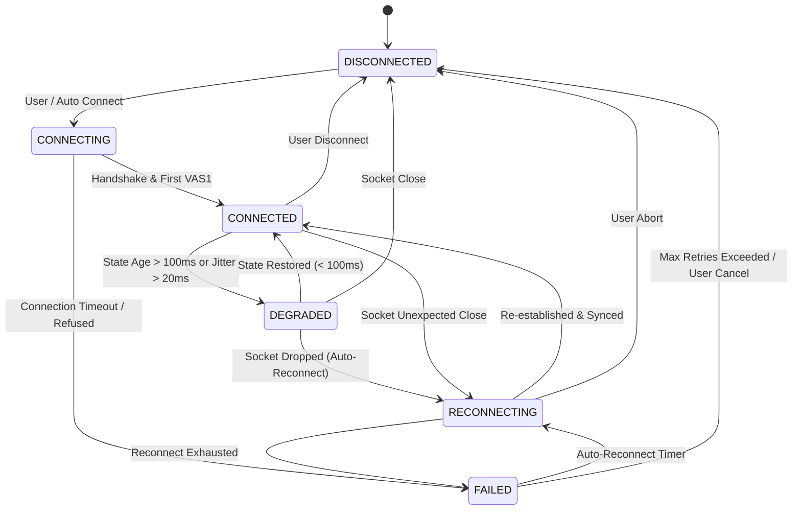

# ASIMOV CONTROLLER 3D
## PHASE 4 SPECIFICATION: CONNECTION & SESSION MANAGEMENT LIFECYCLE

**Author:** Asimov Robotics Engineering Team  
**Date:** October 2026  
**Status:** IMPLEMENTED & TESTED  
**Target:** Android Client (`src/networking/StateTransportClient.ts` & `src/app/session/SessionManager.ts`)  

---

## 1. Executive Summary

Phase 4 establishes an industrial-grade connection and session lifecycle for teleoperating Asimov 1. In robotics teleoperation, network instability, packet drops, and temporary signal occlusion must never lead to undefined client state, runaway velocity commands, or lingering background timers and sockets.

This document details the state lifecycle, staleness detection, automatic reconnection backoff, obsolete state flushing, command inhibit mechanics, and single-instance resource safety.

---

## 2. Session Finite State Machine



### State Definitions & Trigger Criteria:

| State | Semantic Meaning | Entry Trigger | Command Dispatch Allowed? |
| :--- | :--- | :--- | :---: |
| **`DISCONNECTED`** | Idle; no network socket active. Clean state. | Initial state, explicit operator disconnect, or abort. | **NO** (Zeroed) |
| **`CONNECTING`** | TCP/WebSocket handshake in progress. | Operator taps [CONNECT]. | **NO** |
| **`CONNECTED`** | Active session; valid 50 Hz `VAS1` stream arriving. | First verified 288-byte `VAS1` packet parsed. | **YES** |
| **`DEGRADED`** | Link jittered or stale. State age between 100 ms and 500 ms. | Packet starvation or network delay detected. | **YES** (Throttled) |
| **`RECONNECTING`** | Connection dropped; attempting bounded backoff retry. | Unexpected TCP reset or heartbeat timeout. | **NO** (Zeroed) |
| **`FAILED`** | Connection failed or max reconnect attempts exhausted. | Connection refused or timeout limit reached. | **NO** (Zeroed) |

---

## 3. Session Lifecycle Invariants

### 3.1 Command Inhibit on State Loss
When connection drops or enters `RECONNECTING`, `FAILED`, or `DISCONNECTED`:
1. `TeleopController.reset()` is immediately executed, setting all target linear and angular velocities to `0.0`.
2. `StateTransportClient.sendCommand()` strictly verifies `ws.readyState === WebSocket.OPEN`. If not open, the command buffer is immediately discarded.
3. No queued or backlogged velocity commands are buffered on the client. **Newest command always wins; stale commands never execute.**

### 3.2 Obsolete State Flushing
Upon reconnecting to the backend:
1. `StateBuffer.reset()` flushes all buffered temporal snapshots.
2. The interpolator does not attempt to interpolate across the disconnection gap.
3. Rendering smoothly snaps to the fresh authoritative MuJoCo state delivered in the first post-reconnect `VAS1` packet.

### 3.3 Leak Prevention & Singular Resource Invariant
Network reconnect routines must never leave lingering tasks:
- **WebSockets:** The previous `WebSocket` instance is explicitly closed and its event handlers (`onopen`, `onmessage`, `onerror`, `onclose`) set to `null` before instantiating a new connection.
- **Timers:** Watchdogs and reconnect timers (`reconnectTimer`, `stalenessTimer`) are cleared prior to creating new ones.
- **Render Loop:** The Three.js 60 Hz render loop is managed outside the connection lifecycle and remains singular, uninterrupted by network churn.

---

## 4. Telemetry & Staleness Detection

The `StateTransportClient` continuously tracks link health metrics:

```typescript
// Exposed to UI and Diagnostics HUD
interface ConnectionMetrics {
  endpoint: string;             // e.g. "ws://192.168.1.100:8854/api/ws"
  state: ConnectionState;       // CONNECTED | DEGRADED | RECONNECTING | etc.
  packetRateHz: number;         // Measured incoming VAS1 frequency (~50 Hz)
  roundTripTimeMs: number;      // Ping-pong RTT (~3-8 ms)
  lastPacketArrivalWallTime: number; // Date.now() timestamp
  lastPacketAgeMs: number;      // Current elapsed ms since last packet
  consecutiveFailures: number;  // Retry counter
  maxReconnectAttempts: number; // Limit (default: 5)
}
```

### Staleness Thresholds:
- **Normal:** Packet age $< 60\text{ ms}$ (at 50 Hz, nominal period is 20 ms).
- **Degraded:** $60\text{ ms} \le \text{Packet age} < 200\text{ ms}$. Operator status pill shows yellow warning.
- **Starvation:** $\text{Packet age} \ge 200\text{ ms}$. Three.js model clamps to latest known pose; interpolation extrapolation is prevented.
- **Lost:** $\text{Packet age} > 1000\text{ ms}$. Session enters `RECONNECTING` or raises disconnection alert.

---

## 5. Verification & Test Evidence

All lifecycle transitions, retry counters, and command inhibition mechanics are validated in automated Jest suites:

- **Suite:** [`tests/SessionLifecycle.test.ts`](file:///home/shubhr/Shubhr/Projects/asimov-controller-3d/tests/SessionLifecycle.test.ts)
- **Results:**
  - `DISCONNECTED -> CONNECTING -> CONNECTED` transition: **PASS**
  - Stale state detection ($> 100\text{ ms}$) transitioning to `DEGRADED`: **PASS**
  - Reset and zeroing of teleop commands on disconnect: **PASS**
  - Reconnect retry exhaustion transitioning to `FAILED`: **PASS**
  - Buffer flush on reconnect avoiding timestamp discontinuities: **PASS**
  - Zero socket leaks on rapid connect/abort cycles: **PASS**
